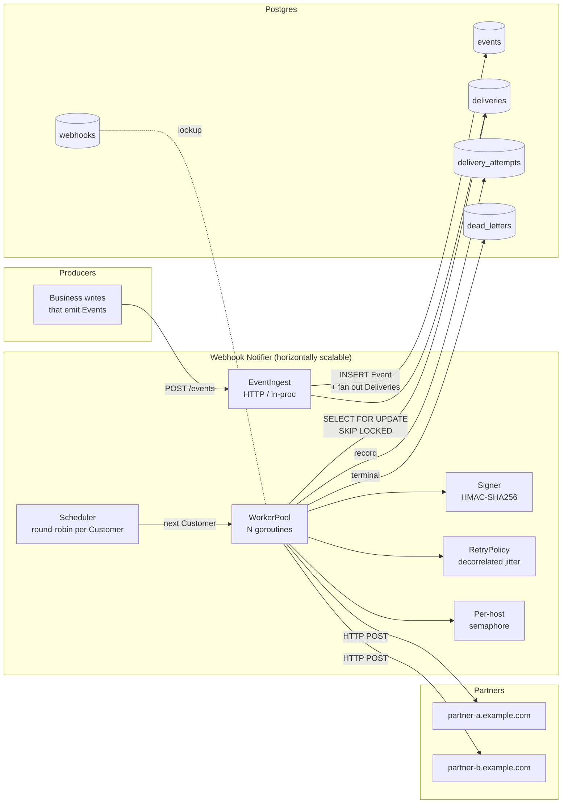
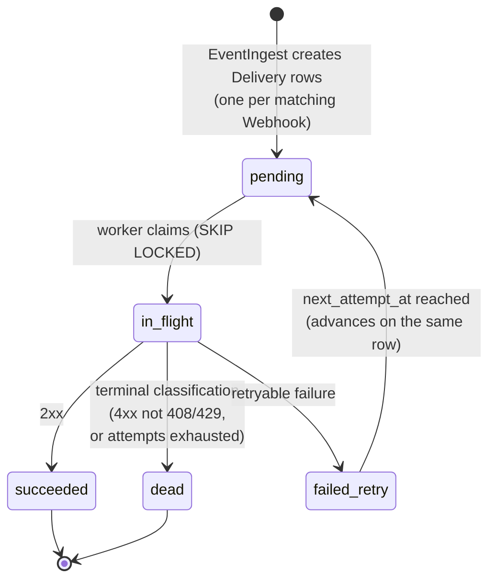

# Webhook Notifier — Design

This document describes the design of the Webhook Notifier component: a service that consumes business Events from a multi-tenant platform and reliably delivers them to Integration Partners over HTTP POST, with horizontal scalability and fair scheduling across Customers of vastly different sizes.

Vocabulary used here is defined in [CONTEXT.md](../CONTEXT.md). Architectural commitments are anchored in [ADR-0001](adr/0001-round-robin-fairness-with-pluggable-scheduler.md), [ADR-0002](adr/0002-postgres-as-queue-no-broker-for-poc.md), and [ADR-0003](adr/0003-retry-policy-and-delivery-lifecycle.md).

## Goals

- **Reliability**: no Event lost between business commit and final terminal state. Transient failures are retried with bounded backoff; persistent failures land in the DLQ for inspection.
- **Scalability**: workers are stateless and horizontally scalable. Adding workers increases throughput without changing claim semantics.
- **Fairness**: a Whale Customer cannot starve Small Customers. Scheduling latency for a Small Customer is bounded regardless of any other Customer's backlog. Fairness is **weighted per Customer**, with a default weight of `1` for every Customer — i.e. equal share today, with a forward-compatible path to differentiated shares (e.g. plan-tier or Whale throttling) without touching the WorkerPool or Outbox.

## Non-goals (PoC)

- Webhook management APIs (assumed implemented elsewhere).
- Strict per-Customer FIFO. Per-Customer queues drain in arrival order single-threaded, but with multiple workers some interleaving is possible. Documented trade-off.
- Multi-region delivery.
- Production-grade auth on the ingest path.
- Partner-side replay UI; the DLQ is a queryable table.

## High-level architecture



## Component responsibilities

### Deep modules (pure logic, isolated unit tests)

- **Scheduler** — Given the set of Customers with pending Deliveries, returns the next Customer to serve. Smooth Weighted Round Robin (SWRR, Nginx-style) with `weight=1` default for every Customer (ADR-0001) — degenerates to plain RR until weights diverge. The interface is the load-bearing contract; the implementation (RR / SWRR / DRR) is the trade-off.
  ```go
  type Scheduler interface {
      // Pick returns the next Customer to serve and a batch hint equal to that
      // Customer's weight: the worker MAY claim up to batchHint Deliveries
      // before yielding back. batchHint == 0 means "no work".
      Pick(ctx context.Context) (id CustomerID, batchHint uint32, ok bool, err error)
      Notify(CustomerID) // wake the scheduler when work arrives
  }

  // WeightSource resolves a Customer's fairness weight. Default impl returns 1
  // for every Customer; future impls read from `customers.weight` (DB) or a
  // plan-tier lookup. The Scheduler depends on this interface, not on storage.
  type WeightSource interface {
      Weight(CustomerID) uint32 // 0 = paused; >=1 = share multiplier
  }
  ```
  SWRR interleaves picks so a `[3,1]` weight set yields `ABAA ABAA` rather than `AAAB AAAB` — same share, no contiguous bursts that would starve the low-weight Customer for several slots. With all weights=1, behaviour is identical to plain RR. A Whale tier with `weight=3` gets 3× share *and* a `batchHint=3` so its worker amortizes one Pick over up to 3 PG claims, improving throughput on its index range without breaking the share invariant. A throttled Customer with `weight=0` is skipped entirely (useful for incident response).
- **RetryPolicy** — `Next(attempt int, prevDelay time.Duration, resp *http.Response, err error) (delay time.Duration, terminal bool, reason string)`. Pure function. Encodes decorrelated jitter, 4xx fast-fail, 429 `Retry-After` honouring, and exhaustion (ADR-0003).
- **Signer** — `Sign(secret, body []byte, ts time.Time) (sig string)`. HMAC-SHA256 over `timestamp.body`. Deterministic.

### Service modules

- **EventIngest** — Accepts an Event and synchronously fans out one Delivery row per matching Webhook in a single transaction. Same transaction = no Delivery is ever orphaned from its Event.
- **Outbox** (the `deliveries` table) — The durable work queue. Workers claim with `SELECT ... FROM deliveries WHERE customer_id = $1 AND status IN ('pending') AND next_attempt_at <= now() FOR UPDATE SKIP LOCKED LIMIT $2` once the Scheduler has named a Customer; the `LIMIT` is the `batchHint` returned by `Pick` (1 by default; higher for weighted tiers).
- **WorkerPool** — N goroutines per process. Each loop:
  1. `id, batchHint, ok := Scheduler.Pick()` — get next Customer and how many Deliveries the worker may serve before yielding.
  2. Claim up to `batchHint` Deliveries for that Customer (single SQL statement, `LIMIT $batchHint`). With default `weight=1`, this is one Delivery.
  3. For each claimed Delivery, in order:
     - Look up Webhook (cached).
     - Acquire per-host semaphore (skip and requeue with short backoff if blocked > short timeout; yield back to Scheduler so a saturated partner does not stall fairness).
     - `Signer.Sign()`, build HTTP request with idempotency headers.
     - POST with timeout.
     - `RetryPolicy.Next()` decides outcome → mutate Delivery row + record an Attempt row.
  4. Return to step 1.
- **SubscriptionRegistry** — Read-only `customer_id → []Webhook`. In-memory LRU with short TTL; cache miss falls back to PG. Avoids hot lookup on every Delivery.
- **DLQ** (`dead_letters` table) — Terminal Deliveries with reason (`exhausted`, `terminal_4xx`, `terminal_network`).
- **Per-host semaphore** — `map[host]chan struct{}`. Concurrency cap per partner hostname, default 20. Protects partner endpoints from self-inflicted DoS when many Deliveries target the same host.

## Data model

```
events                deliveries             delivery_attempts      dead_letters
─────────────         ───────────────        ─────────────────      ───────────────
id (uuid)             id (uuid)              delivery_id            delivery_id
customer_id           event_id        ──fk─> id                     last_error
type                  webhook_id             attempt_number         attempts
payload (jsonb)       customer_id            status_code            reason
created_at            status                 error_class            final_at
                      attempt_count          duration_ms
                      next_attempt_at        sent_at
                      last_error
                      created_at
                      updated_at

webhooks
───────────
id (uuid)
customer_id
url
secret (encrypted)
event_types (text[])
active (bool)
```

Indexes:
- `deliveries (customer_id, status, next_attempt_at)` — scheduler/worker hot path.
- `delivery_attempts (delivery_id, attempt_number)` — audit lookup.
- `dead_letters (final_at desc)` — ops inspection.

## Lifecycle: a Delivery from cradle to terminal state



`failed_retry` is a distinct state from `pending` so dashboards distinguish "never tried" from "in backoff".

## Reliability mechanics

- **Outbox semantics**: Events and their derived Deliveries are written in the same transaction as the business write that emitted them. No business commit without scheduled delivery.
- **Claim atomicity**: `SELECT ... FOR UPDATE SKIP LOCKED` ensures no two workers ever claim the same Delivery, even across multiple instances of the service.
- **Crash recovery**: a worker that crashes mid-Delivery leaves the row in `in_flight` with `claimed_at`. A background sweeper (or a `claimed_at < now() - lease_ttl` predicate in the claim query) re-claims abandoned rows. PoC uses the latter — no separate sweeper process.
- **Idempotency contract**: every Attempt carries `X-Delivery-Id` (stable across retries of one Delivery) and `X-Event-Id` (stable across all Deliveries derived from one Event). Partners dedupe on these.

## Scalability mechanics

- **Stateless workers**: all coordination is through Postgres. Workers can be added or removed without coordination.
- **No leader**: the Scheduler is process-local. Each instance independently round-robins its own claimed Deliveries; global fairness emerges because all instances claim from the same `deliveries` table.
- **Scale ceiling**: at very high throughput, contention on the `deliveries` claim query becomes the bottleneck. The natural next step is to partition by `customer_id` (or move per-Customer queues to Redis Streams). The `Scheduler` interface already hides the queue source so this swap is local.

## Fairness mechanics

The single technical claim that drives most of the design: **the unit of fairness is the Customer, not the Delivery, not the worker, not the partner host**.

- The Scheduler iterates over **the set of Customers with pending Deliveries**, not over the Deliveries themselves. This is the key insight. If we iterated over Deliveries, a Whale's 50k-Delivery burst would dominate. Iterating over Customers gives each one a share per cycle proportional to its weight, regardless of backlog depth.
- **Weighted by default, equal by default.** Every Customer carries a `weight` (default `1`). The Scheduler is Smooth Weighted Round Robin (SWRR): with uniform weights it is plain RR; with diverging weights it allocates proportional, interleaved slots (no contiguous bursts for high-weight Customers). This makes the equal-share PoC and a future tiered policy the same code path — no rewrite when product introduces plan tiers, Whale throttling, or paid priority.
- **Weight doubles as a throughput knob.** `Pick` returns a `batchHint == weight` so a worker serving a high-weight Customer may claim multiple Deliveries per Pick, amortizing the scheduler hop and the per-Customer PG index lookup. With `weight=1` (the PoC default) batch is 1, maximally fair and maximally chatty; raising weight raises both share *and* per-Pick throughput without disturbing the share invariant.
- Per-host concurrency cap is **orthogonal** to per-Customer fairness. It protects partners. Without it, a Whale's per-cycle Delivery slots still get through, but in close succession against the same hostname — partners 429. On cap timeout the worker requeues with a short `next_attempt_at` bump and returns to the Scheduler, so a saturated partner never blocks Pick.
- SWRR is sufficient because Deliveries have uniform cost (one HTTP POST each) and weights are per-Customer, not per-Delivery. DRR exists for variable-cost work units; if Deliveries ever become heterogeneous (e.g. payload-size-weighted), the Scheduler implementation swaps without touching the WorkerPool (ADR-0001).

### Weight source

```
customers
──────────
id (uuid)
weight (int, default 1, check >= 0)  -- 0 = paused
plan_tier (text, nullable)            -- optional; resolves to weight via policy
```

PoC reads weight from the `customers` table via `WeightSource`. Cache alongside the SubscriptionRegistry (short TTL). Live weight changes apply at the next Scheduler cycle — no worker restart.

## Per-host concurrency cap

```go
type HostLimiter struct {
    mu    sync.Mutex
    sems  map[string]chan struct{}
    limit int
}

func (h *HostLimiter) Acquire(ctx context.Context, host string) (release func(), err error) { ... }
```

Workers acquire before POSTing. On acquisition timeout the Delivery is requeued with a short `next_attempt_at` bump — the worker frees up to serve another Customer. This keeps fairness intact even when one partner is saturated.

## Observability

Metrics are flagged as a discussion point in the assignment brief, but the PoC ships with the endpoints and instrumentation hooks so the discussion has concrete artefacts:

- **Prometheus `/metrics`** with:
  - `webhook_deliveries_total{status="succeeded|dead"}`
  - `webhook_delivery_latency_seconds{customer_class="whale|small"}` (histogram, enqueue → terminal)
  - `webhook_attempts_per_delivery` (histogram)
  - `webhook_dlq_total{reason}`
  - `webhook_scheduler_pick_duration_seconds`
  - `webhook_host_semaphore_wait_seconds{host}`
- **`/health`** and **`/ready`** endpoints.
- **`/debug/pprof`** mounted behind a flag.
- **Structured logging** via `log/slog` with `customer_id`, `event_id`, `delivery_id`, `attempt_number` fields on every line.

Dashboards and alerting are pair-session discussion: which p99 thresholds warrant paging, what fairness-violation alerts look like, how to detect a slow partner before its queue depth blows the SLO.

## Testing strategy

### Unit tests

- **Scheduler**: table-driven coverage of empty schedule, single-Customer back-to-back, multi-Customer round-robin invariant, and weighted invariant. Property test: over any arrival/draw sequence, each Customer's share equals `weight_i / Σ weight_j ± ε`. Uniform-weight case reduces to the equal-share invariant. `weight=0` Customers are never picked while pending.
- **RetryPolicy**: truth table from ADR-0003.
- **Signer**: vector tests with known fixtures.

### Integration tests

- **Outbox claim atomicity**: real Postgres (testcontainers). Spawn K concurrent workers, claim N Deliveries, assert no duplicates.
- **End-to-end happy path**: ingest → POST → success → row state.

### Benchmark scenarios

Each scenario lives in `cmd/bench` and emits a markdown report under `bench/results/`. The four scenarios collectively cover all reliability/fairness/scalability claims.

| Scenario | Setup | Pass criteria | Claims exercised |
| --- | --- | --- | --- |
| **1. Fairness under load + late-arrival reactivity** | 1 Whale (50k Deliveries burst) + 100 Smalls (5 each, 1/sec). At t=30s inject a brand-new Small. | Smalls p99 < 2s; late Small first-Delivery latency bounded to one RR cycle. | Steady-state fairness, scheduler reactivity. |
| **2. Transient + recovering partners** | 10 Customers, Webhooks split across 3 partners. Partner B: 30% 5xx. Partner C: down for 30s then recovers. | 100% terminal; Partner-C Deliveries succeed after recovery; Partner-A latency unaffected. | Retry policy, decorrelated jitter (no thundering herd), per-host isolation. |
| **3. Terminal classification (fail-fast on 4xx)** | 1 Customer, 2 Webhooks: one good, one returning 404. 1000 Events. | Broken Webhook Deliveries: 1 Attempt each → `dead` with `reason=terminal_4xx`. Good Webhook: all `succeeded`. | Terminal classification, no retry waste on misconfig. |
| **4. Horizontal scale + claim atomicity + idempotency** | 10k Deliveries at worker count {1, 4, 8}. Receiver records every `(delivery_id, attempt_number, X-Delivery-Id)` tuple. | Throughput at 8 ≥ 4× throughput at 1. Zero duplicate `(delivery_id, attempt_number)`. `X-Delivery-Id` stable across retries. | Scalability, claim atomicity, idempotency-header stability. |

## What is deliberately out

- **DRR implementation** — interface ready, implementation deferred (ADR-0001). PoC ships WRR with uniform weights.
- **Plan-tier → weight policy** — the WRR + `WeightSource` plumbing is in place, but the actual tier table and admin UI to set non-uniform weights are out of PoC scope. Adding them is a config change, not a redesign.
- **Redis Streams per-Customer queues** — same Scheduler interface (ADR-0002).
- **Per-Customer concurrency cap** — round-robin already paces; documented as natural addition under DRR.
- **Many-Whale contention bench** — scenario 1 already proves the mechanism.
- **Mid-flight worker crash chaos scenario** — recoverable by design (`claimed_at` predicate), demonstrated by an integration test rather than a bench scenario.
- **Multi-region**.
- **Webhook management APIs**.

## Risks and open trade-offs

- **No strict per-Customer FIFO.** Documented; partners are expected to handle out-of-order Events on their side using `X-Event-Id` and `created_at`.
- **In-process Scheduler means per-instance round-robin.** Fairness across instances emerges from claim semantics, not coordination. Under extreme imbalance (e.g. one instance serving only one Customer due to claim luck) fairness could degrade briefly. Bounded by claim batch size.
- **Postgres as queue has a throughput ceiling.** Bench scenario 4 measures it; the scale-out path is in ADR-0002.

## Repo layout (planned)

```
.
├── CONTEXT.md
├── CLAUDE.md
├── docs/
│   ├── DESIGN.md
│   └── adr/
├── cmd/
│   ├── notifier/       # service entrypoint
│   └── bench/          # benchmark harness CLI
├── internal/
│   ├── ingest/
│   ├── scheduler/      # Scheduler interface + round-robin impl
│   ├── retry/          # RetryPolicy
│   ├── signer/         # Signer
│   ├── worker/         # WorkerPool, host limiter
│   ├── outbox/         # Postgres claim/persist
│   ├── registry/       # SubscriptionRegistry
│   └── observe/        # metrics, logging, pprof wiring
├── migrations/         # golang-migrate SQL files
├── bench/
│   ├── receiver/       # configurable test receiver
│   ├── scenarios/      # scenario drivers
│   └── results/        # committed run outputs
├── docker-compose.yml
├── Makefile
└── go.mod
```
