# Webhook Notifier — Design

This document describes the design of the Webhook Notifier component: a service that consumes business Events from a multi-tenant platform and reliably delivers them to Integration Partners over HTTP POST, with horizontal scalability and fair scheduling across Customers of vastly different sizes.

The focus is **what** each architectural choice provides and **why** it exists.
Operational execution steps live in [WORKFLOW.md](WORKFLOW.md); implementation
details live in the code and ADRs.

Vocabulary used here is defined in [CONTEXT.md](../CONTEXT.md). Architectural commitments are anchored in [ADR-0001](adr/0001-round-robin-fairness-with-pluggable-scheduler.md), [ADR-0002](adr/0002-postgres-as-queue-no-broker-for-poc.md), [ADR-0003](adr/0003-retry-policy-and-delivery-lifecycle.md), [ADR-0004](adr/0004-requeue-without-attempt.md), [ADR-0005](adr/0005-subscription-registry-lru-ttl-cache.md), [ADR-0006](adr/0006-db-backed-claimable-customer-discovery.md), [ADR-0007](adr/0007-http-transport-and-response-body-drain.md), [ADR-0009](adr/0009-retry-max-age-expiration.md), [ADR-0010](adr/0010-terminal-delivery-retention-archive.md), [ADR-0011](adr/0011-delivery-claims-authoritative-claim-store.md), [ADR-0012](adr/0012-pgbouncer-prepared-statements-and-pgxpool-deferral.md), [ADR-0013](adr/0013-claim-agnostic-claimable-customer-discovery.md), and [ADR-0014](adr/0014-in-memory-webhook-circuit-breaker.md). [ADR-0008](adr/0008-persisted-webhook-circuit-breaker.md) records the earlier circuit-breaker design and is superseded by ADR-0014.
For a step-by-step execution path and tuning checklist, see [WORKFLOW.md](WORKFLOW.md).

The implementation is Go plus Postgres. Go keeps the service small,
concurrent, and easy to run as many replicas without durable local state. Postgres is used
as both durable outbox and coordination point for the PoC: it stores Events,
Delivery work, Attempts, terminal state, and atomic claims through transactional
SQL. This avoids adding a broker while still demonstrating reliability,
horizontal scaling, and Customer-fair scheduling.

## Goals

- **Reliability**: no Event accepted by the notifier is lost between its ingest commit and final terminal state. Transient failures are retried with bounded backoff; persistent failures land in the DLQ for inspection. An upstream transactional outbox is still required to make the handoff from the producer's business transaction atomic.
- **Scalability**: workers keep only disposable process-local scheduling and protection state; durable work and coordination remain in Postgres. Replicas can be added without changing claim semantics.
- **Fairness**: a Whale Customer cannot starve Small Customers. Customer-based
  rotation gives Small Customers opportunities to progress despite a Whale
  backlog; the maintained benchmark measures this as comparative Small-versus-
  Whale P95 First-Attempt Queue Latency rather than claiming an absolute latency
  bound. The default runtime gives every Customer equal share through plain
  round-robin scheduling; the Scheduler contract also supports an opt-in
  weighted path for differentiated shares without touching the WorkerPool or
  Outbox.
- **Runnable service composition**: the notifier entrypoint wires ingest, Registry, Scheduler, Outbox, HostLimiter, WorkerPool, DB-backed discovery, observability, and graceful shutdown. Package-level tests and benchmark drivers exercise mechanics, but do not replace a runnable service.

## Non-goals (PoC)

- Webhook management APIs (assumed implemented elsewhere).
- Strict per-Customer FIFO. Per-Customer queues drain in arrival order single-threaded, but with multiple workers some interleaving is possible. Documented trade-off.
- Multi-region delivery.
- Production-grade auth on the ingest path.
- Partner-side replay UI; the DLQ is a queryable table.

## High-level architecture

Human-readable architecture diagrams live in [docs/animations/](animations/).
The rendered [overall architecture](animations/overall-architecture.svg) shows
the full path; focused renders cover multi-Customer claiming, retry
classification, Webhook circuit breaker lifecycle, and host limiter requeue
behavior.

[Open the full-size architecture diagram](animations/overall-architecture.svg)



## Component interaction

The high-level diagram above shows the coarse system shape. This diagram shows
the main runtime interactions between the notifier components and Postgres
tables. Detailed mechanics are in the rendered diagrams for
[claiming](animations/claim-next-batch.svg),
[retry](animations/retry-policy.svg),
[breakers](animations/breaker-lifecycle.svg), and
[host limiting](animations/host-limiter.svg).

The focused rendered diagrams make the main design reasons visible without
requiring source-code reading:

- [Multi-Customer claiming](animations/claim-next-batch.svg) explains how DB
  amortization is kept compatible with Customer fairness.
- [Retry policy](animations/retry-policy.svg) separates retryable failures from
  terminal outcomes.
- [Circuit breaker lifecycle](animations/breaker-lifecycle.svg) shows why
  decisions are local but claim-visible state is persisted.
- [Host limiting](animations/host-limiter.svg) shows why local partner pressure
  causes a Requeue rather than an Attempt.

### Multi-Customer Claiming



### Retry Classification



### Webhook Circuit Breaker



### Host Limiting



## Component responsibilities

### Deep modules (pure logic, isolated unit tests)

| Component | Responsibility | Why |
|---|---|---|
| **Scheduler** | Chooses which Customer receives delivery capacity next. | A global Delivery FIFO lets Whale traffic dominate. The default equal-share round-robin satisfies the assignment; internal SWRR preserves the same contract when differentiated shares are needed. Weight affects pick frequency; claim batch size is a separate database-efficiency choice (ADR-0001). |
| **RetryPolicy** | Decides whether an Attempt succeeded, should retry, or should become terminal. | Keeps retry semantics consistent and testable across all Workers. Covers decorrelated jitter, terminal 4xx, `Retry-After`, exhaustion, and optional MaxAge expiry; `MaxAge = 0` is the runtime default. See the [rendered retry flow](animations/retry-policy.svg) and ADR-0003/ADR-0009. |
| **Signer** | `Sign(secret, body []byte, ts time.Time) (sig string)`. HMAC-SHA256 over `timestamp.body`. Deterministic. | (pure logic, no external dependency) |

### Service modules

| Component | Core function | Key design note | Reference |
|---|---|---|---|
| **EventIngest** | Accepts an Event and synchronously fans out one Delivery row per matching Webhook in a single notifier transaction. | Keep synchronous fanout for the PoC. Track ingest latency by fanout size; provisional `p99 < 200ms` threshold for reconsidering async fanout. | — |
| **Outbox** (`deliveries` table) | Durable work queue and authoritative claim store. | Claim batching reduces DB round-trips; per-Customer candidate cap prevents Whale monopolization. | [claim flow](animations/claim-next-batch.svg), ADR-0011, ADR-0012 |
| **WorkerPool** | Converts fair Customer picks into signed HTTP Attempts and durable outcomes. | Bounded parallelism, batch marks, HostLimiter, and RetryPolicy keep throughput from weakening fairness or partner protection. | [WORKFLOW.md](WORKFLOW.md) |
| **SubscriptionRegistry** | Read-only `(customer_id, event_type) → []Webhook` lookup for ingest fanout. | In-memory LRU with 30s TTL + singleflight miss coalescing. Claimed Delivery metadata is fetched through Outbox, not this cache. | ADR-0005 |
| **DLQ** (`dead_letters` table) | Terminal Deliveries (`exhausted`, `terminal_4xx`, `age_exceeded`). | Written at MarkDead time alongside `deliveries.status = 'dead'`. Terminal rows archived to `delivery_history` after configurable retention window (default 24h). | ADR-0010 |
| **HostLimiter** (process-local) | Bounds concurrent Attempts to one Integration Partner hostname (default 20 per process). | Prevents one partner from consuming local egress capacity. Production still needs fleet-wide coordination. | [host-limiter flow](animations/host-limiter.svg) |
| **Webhook circuit breaker** | Stops a persistently failing Webhook from consuming worker capacity. | Process-local decisions for cheap hot path; persisted transitions so all replicas filter the same open Webhooks. Half-open probe is cluster-wide. | [breaker lifecycle](animations/breaker-lifecycle.svg), ADR-0014 |

## Data model

```
events                deliveries             delivery_claims        delivery_attempts      dead_letters
─────────────         ───────────────        ──────────────         ─────────────────      ───────────────
id (uuid)             id (uuid)              delivery_id (uuid PK)  delivery_id            delivery_id
customer_id           event_id        ──fk─> id                     id                     last_error
type                  webhook_id             attempt_number         attempt_number         attempts
payload (jsonb)       customer_id            claimed_at             status_code            reason
created_at            status                                        error_class            final_at
                      attempt_count                                 duration_ms
                      next_attempt_at                               sent_at
                      last_error
                      last_delay_millis
                      created_at
                      updated_at

webhooks
───────────
id (uuid)
customer_id
url
url_host (generated text)
secret_encrypted
secret_previous (nullable)
secret_rotated_at (timestamptz, nullable)
event_types (text[])
active (bool)
breaker_state (text)
breaker_failure_count
breaker_opened_at
breaker_next_probe_at
breaker_cooldown_ms
breaker_probe_delivery_id

customers                              delivery_history (partitioned)
──────────                             ─────────────────────────────
id (text)                              delivery_id + final_at (PK)
class (int, default 1, check >= 0)     event_id, webhook_id, customer_id
                                       event_type, url_host
                                       final_status, terminal_reason
                                       attempt_count, first/last_attempt_at
                                       last_status_code, last_error_class, last_error
                                       delivery_created_at, final_at, archived_at
```

| Table | Role |
|---|---|
| `events` | Stores the accepted business Event payload once. |
| `webhooks` | Stores Integration Partner subscriptions, signing material, and breaker state. |
| `customers` | Stores Customer identity and optional scheduling class for the weighted path. |
| `deliveries` | Live Postgres work queue: one row per Event/Webhook fanout target. |
| `delivery_claims` | Authoritative worker-claim lease table (ADR-0011). |
| `delivery_attempts` | Audit trail of HTTP Attempts that reached dispatch. |
| `dead_letters` | Terminal failure metadata for operational inspection. |
| `delivery_history` | Archived terminal Deliveries (partitioned, after live-queue retention window). |

`delivery_claims` is the authoritative claim store (ADR-0011). A Delivery is claimed when a row exists in `delivery_claims` with `claimed_at` within the claim lease window. The `deliveries.status` column no longer stores `in_flight`; claim queries join against `delivery_claims` to detect already-claimed rows. `deliveries.claimed_at` (a residual column from the initial schema) is no longer used as the claim source.

`dead_letters` records terminal metadata at MarkDead time. The `deliveries` row persists with `status = 'dead'` until the archive process copies it into `delivery_history` (a time-partitioned table) and deletes it from the live queue (ADR-0010).

Indexes:
- `deliveries (customer_id, status, next_attempt_at)` — scheduler/worker hot path.
- `deliveries (customer_id, next_attempt_at, created_at, id) WHERE status IN ('pending', 'failed_retry')` — ready-candidate claim scan (partial, index-friendly).
- `delivery_claims (claimed_at, delivery_id)` — stale-claim scan.
- `delivery_attempts (delivery_id, attempt_number)` — audit lookup.
- `delivery_attempts (delivery_id, sent_at)` — Attempt audit lookup by Delivery and time. Breaker failure counting is process-local and no longer scans Attempt history in mark transactions.
- `deliveries (webhook_id)` — Webhook-scoped Delivery maintenance, including blocked-Delivery deferral when a breaker opens.
- `deliveries (customer_id, next_attempt_at) WHERE status IN ('pending', 'failed_retry')` — claimable-customer discovery scan.
- `dead_letters (final_at desc)` — ops inspection.
- `delivery_history (customer_id, final_at desc)` — historical lookup.

## Lifecycle: a Delivery from cradle to terminal state

[Open the full-size Delivery lifecycle](animations/delivery-lifecycle.svg)



`claimed` is not a persisted `deliveries.status` value. It is represented by a row in the `delivery_claims` table (ADR-0011). When a claim is active the Delivery's `status` remains `pending` or `failed_retry`; the claim ownership lives in `delivery_claims`. Claim queries join against `delivery_claims` to detect already-claimed rows and project a synthetic `'in_flight'` status for the worker. Stale claims (older than `claimLease`) are reclaimed atomically by the claim query's `ON CONFLICT … DO UPDATE WHERE claimed_at < now() - lease` clause — no separate sweeper process.

## Reliability mechanics

| Mechanism | How it works |
|---|---|
| **Notifier acceptance atomicity** | The notifier writes an accepted Event and all derived Deliveries in one Postgres transaction. Prevents partial fanout inside the notifier. Does not atomically include the upstream business write — that requires a producer-side transactional outbox. |
| **Claim atomicity** | Claim CTE selects candidates with `FOR UPDATE SKIP LOCKED` and inserts into `delivery_claims` using `INSERT … ON CONFLICT (delivery_id) DO UPDATE WHERE claimed_at < now() - lease`. Handles worker races: one succeeds on INSERT, the other's DO UPDATE is blocked by the WHERE clause unless the claim is stale. |
| **Crash recovery** | No separate sweeper. The claim CTE handles recovery in two stages: (1) `stale_candidate` CTE selects rows with `claimed_at` older than the lease TTL (default 5 min); (2) `INSERT … ON CONFLICT DO UPDATE WHERE claimed_at < now() - lease` atomically reclaims stale claims — a new worker steals without a timeout loop. |
| **Lock ordering** | Every transaction that locks both tables acquires `deliveries` first, then `delivery_claims`. The claim path locks `deliveries` with `FOR UPDATE SKIP LOCKED` first; `withInFlightDelivery` uses ordered CTEs. Inverted ordering produces `SQLSTATE 40P01` deadlock aborts. |
| **Idempotency contract** | Every Attempt carries `X-Delivery-Id` (stable across retries of one Delivery) and `X-Event-Id` (stable across all Deliveries from one Event). Partners dedupe on these. |

## Security

| Concern | Design | Production gap |
|---|---|---|
| **Replay protection** | Partners reject when `abs(now() - X-Signature-Timestamp) > 5 min`. HMAC binds timestamp to body. | — |
| **Secret storage** | Schema column named `secret_encrypted`, but PoC passes value directly to HMAC Signer. | Must encrypt at rest and decrypt only at the delivery boundary. |
| **Secret rotation** | `webhooks.secret_previous` and `secret_rotated_at` support a grace window. Partners accept signatures from either secret during rotation. | Management API and rotation cleanup job are outside this PoC. |
| **Signer behavior** | Always signs with the current secret. Dual-acceptance during rotation is a partner-side verification concern, not a second signing path. | — |

## Scalability mechanics

| Mechanism | What it does | Why / trade-off |
|---|---|---|
| **No durable local state** | Scheduler membership, HostLimiter counters, breaker decisions are process-local and rebuildable. Durable state lives in Postgres. | Replicas can be added or removed without transferring local state. |
| **PgBouncer + prepared statements** | Local stack runs `edoburu/pgbouncer:v1.25.1-p0` with `MAX_PREPARED_STATEMENTS` non-zero. Notifier keeps pgx cached-statement mode. | Hot claim and mark CTEs avoid repeated server parse/plan work while still using PgBouncer transaction pooling. |
| **Shared HTTP transport** | One tuned HTTP client shared across all Workers, with large idle connection pools and explicit transport timeouts (ADR-0007). | Per-Attempt deadlines come from request contexts, not `http.Client.Timeout`, so bodies drain before cancellation and connections are reusable. |
| **No leader** | Scheduler is process-local. DB-backed claimable Customer discovery (ADR-0006, ADR-0013) approximates cluster-wide fairness without a globally serialized Scheduler. Discovery is claim-agnostic — it avoids joining `delivery_claims` to keep latency flat with backlog depth (issue #124). | `ClaimNextN` with `FOR UPDATE SKIP LOCKED` remains the sole authority on actual claimability. Workers drop Customers that yield an empty claim via `HasClaimableWork`. |
| **Layered wakeups** | Successful ingest wakes the local Scheduler synchronously and enqueues an advisory remote wake hint. A bounded broadcaster coalesces hints per Customer for 100ms and sends `pg_notify` through a dedicated Postgres connection. | Periodic DB-backed discovery remains the recovery path if a hint is dropped or notification is unavailable. |
| **Scale ceiling** | At very high throughput, `deliveries` claim contention becomes the bottleneck. | Next step: partition by `customer_id`. Migrating to Redis Streams / Kafka is a larger change — the Scheduler interface stays, but outbox/claim/discovery/ingest are Postgres-coupled. |

## Fairness mechanics

The single technical claim that drives most of the design: **the unit of fairness is the Customer, not the Delivery, not the worker, not the partner host**.

- The Scheduler iterates over **the set of Customers with pending Deliveries**, not over the Deliveries themselves. This is the key insight. If we iterated over Deliveries, a Whale's large burst would dominate. Iterating over Customers gives each one a share per cycle proportional to its weight, regardless of backlog depth.
- A Customer with more Webhooks produces more Deliveries but does not receive more scheduling capacity automatically. Webhook fanout increases backlog, not share. Explicit Customer weight is the only mechanism for differentiated scheduling capacity.
- **Per-Customer concurrency cap is a complementary future safeguard.** Round-robin controls admission order, but slow Attempts from one Customer can still accumulate in flight and occupy worker capacity. Customer weight controls scheduling share; a concurrency cap would bound simultaneous resource use. It does not replace Customer-based scheduling.
- A production per-Customer concurrency cap should be fleet-wide. A process-local layer may reduce coordination load, but cannot preserve the deployment-wide bound alone. It can reuse a lease-based distributed semaphore pattern keyed by Customer, independently of the Host Concurrency Cap keyed by Integration Partner.
- **Equal share by default, weighted path available.** The default service uses plain round-robin, so all Customers get equal scheduling share. The Scheduler interface also supports Smooth Weighted Round Robin (SWRR): with uniform weights it degenerates to plain RR; with diverging weights it allocates proportional, interleaved slots (no contiguous bursts for high-weight Customers). The opt-in SWRR runtime path reads `customers.class` as the Customer weight through `dbweights.DBWeightSource`, with `class=0` treated as paused. Because the default path is still the O(1) list+map round-robin implementation, divergent weighted scheduling should be profiled before being treated as the production default.
- **Claim batch size is independent from Customer weight.** Weight controls how often a Customer is picked. Claim batch size controls database amortization per pick. The PoC uses a default minimum batch size of 32 (`MinBatchHint`) and a default upper bound of 64 (`MaxBatchHint`). In single-customer mode, the effective per-pick limit is the scheduler `batchHint` clamped by those worker-side bounds. In multi-customer mode, the total claim limit is the sum of each picked Customer's effective per-pick limit. Tune against the maintained P95 Small-versus-Whale first-Attempt fairness gate rather than changing fairness policy to gain throughput.
- **Cross-customer claim batching.** When `MultiPickCount > 1`, the worker collects up to N Customers from the Scheduler and issues a single `ClaimNextBatch` call — one DB round-trip amortised across many sparse Customers. After the batch claim, `HasClaimableWorkBatch` checks whether empty-pick Customers truly have no work (another worker may have claimed their only row) and removes them from rotation. This is critical for sparse-Customer workloads where per-Customer claim queries would otherwise dominate; benchmark coverage for that workload belongs in [bench/README.md](../bench/README.md).
- **Batch-size tuning guidance.** `MinBatchHint` is the worker-side lower bound for claim batch size per pick (default 32). `MaxBatchHint` is the worker-side upper bound (default 64, `0` means unbounded). In single-customer mode (`claimSingle`), the worker clamps the scheduler hint through those bounds. In multi-customer mode (`claimMulti` / `MultiPickCount > 1`), the worker sums those per-pick limits and passes the total to `ClaimNextBatch`, whose SQL divides the limit back into a fair per-Customer share. Higher values reduce claim-query frequency and often increase peak throughput, but can worsen fairness tail latency because one Customer can occupy a worker longer per turn. Lower values increase pick interleaving and usually improve fairness at the cost of extra DB overhead. In practice: start around `32`–`64` for throughput-focused runs, and `1`–`8` for fairness-sensitive mixed workloads; then tune empirically with benchmark reports. Use `MultiPickCount > 1` to amortise DB round-trips across many sparse Customers without increasing per-Customer batch size.
- The Host Concurrency Cap is **orthogonal** to per-Customer fairness. It protects partners. Without it, a Whale's per-cycle Delivery slots still get through, but in close succession against the same hostname — partners 429. The worker uses non-blocking `TryAcquire`; a local cap miss requeues with a short `next_attempt_at` bump and returns to the Scheduler, so a locally saturated partner does not hold a worker waiting for capacity.
- SWRR is the current weighted-scheduling candidate because Deliveries have uniform cost (one HTTP POST each) and weights are per-Customer, not per-Delivery. DRR exists for variable-cost work units; if Deliveries ever become heterogeneous (e.g. payload-size-weighted), the Scheduler implementation swaps without touching the WorkerPool (ADR-0001).
- The default PoC scheduler is plain round-robin (all Customers equal). It uses `container/list.List` + `map` for O(1) Notify and Remove — membership operations do not degrade with active Customer count. The opt-in SWRR path uses the same list-plus-map membership structure and performs an O(n), zero-allocation weight accumulation pass during Pick. Divergent weighted scheduling should still be separately profiled for the expected active-Customer count before becoming the default.

### Weight source

```
customers
──────────
id (uuid)
class (int, default 1, check >= 0)  -- 0 = paused
```

The default service path ignores `class` for scheduling and uses plain round-robin. The code also supports `EnableWeightedScheduler` in the internal runtime configuration, although the notifier CLI does not currently expose a flag for it. In that path, `dbweights.DBWeightSource` reads `customers.class` through the `WeightSource` interface and caches values for five minutes; `Refresh` can force an earlier reload. There is no database change-notification watcher.

## Per-host concurrency cap

```go
type HostLimiter struct {
    mu    sync.Mutex
    sems  map[string]*semaphore.Weighted
    cfg   HostLimiterConfig
}

func (h *HostLimiter) Acquire(ctx context.Context, host string) (release func(), err error) { ... }
func (h *HostLimiter) TryAcquire(host string) (release func(), err error) { ... }
```

Workers try to acquire before POSTing. If no slot is immediately available, the Delivery is requeued with the limiter's short `RequeueDelay` — the worker frees up to serve another Customer. This keeps fairness intact when one process saturates its local allowance.

The cap sets the upper bound on concurrent in-flight Attempts per Integration
Partner hostname. Approximate per-host throughput is `host_cap /
partner_latency`: a cap of 20 supports about 200 Attempts/s at 100 ms p50
partner latency, or about 400 Attempts/s at 50 ms. The default of 20 is sized
as a conservative starting point for the 300 events/s PoC target when traffic is
spread across multiple partner hostnames; concentrated traffic to one hostname
needs either lower partner latency, a higher configured cap, or more host-level
coordination capacity.

The Host Concurrency Cap is a fleet-wide partner-protection invariant. The PoC's
in-memory HostLimiter enforces only the local portion of that allowance. A
horizontally scaled production deployment needs distributed coordination, such
as a lease-based distributed semaphore. The mechanism is deferred until
deployment scale and failure semantics are known. A request-rate policy, such
as a token bucket, would be a separate control with separate configuration; it
does not enforce the Host Concurrency Cap.

If distributed coordination is configured but unavailable, new Attempts for
affected hostnames fail closed: Requeue them with a short delay rather than
falling back to the local HostLimiter alone. Existing in-flight Attempts
continue. This avoids multiplying Integration Partner load during a limiter
incident. The production implementation should expose coordination-failure
metrics so operators can distinguish limiter outages from partner saturation.

Production coordination should key the cap by normalized `hostname:port`.
Equivalent URLs using a scheme's default port share one key, while distinct
ports may carry independent allowances. The PoC currently keys its local
HostLimiter with `url.Hostname()` only. Webhook paths and Customer identity do
not belong in the key.

Production configuration should provide a conservative default cap plus
per-key overrides for Integration Partners with known capacity. Customer-level
overrides do not belong in this policy because the Host Concurrency Cap protects
Integration Partners, not Customers.

Distributed semaphore slots should be renewable leases. Acquire a slot before
POSTing, renew it while the Attempt remains in flight, release it when the
Attempt finishes, and allow it to expire after missed renewals. The lease TTL
must exceed the renewal interval and be bounded relative to the configured
request timeout so a crashed notifier instance cannot strand partner capacity
indefinitely.

If lease renewal fails while an Attempt is still in flight, cancel the HTTP
request before the lease expires and classify the outcome as retryable
coordination loss. Allowing the request to continue after its slot can be
reissued would violate the cap. A later retry keeps the stable `X-Delivery-Id`
so the Integration Partner can deduplicate an Attempt that reached it before
cancellation took effect.

Coordination loss before POSTing is a Requeue: it does not record an Attempt or
consume the Delivery retry budget because the Integration Partner saw no
request. Renewal loss after POSTing begins records an Attempt and uses normal
retry accounting because the Integration Partner may have observed the request.
Coordination loss does not contribute to opening the Webhook Circuit Breaker:
it indicates notifier infrastructure failure, not Integration Partner
destination health. Expose it through separate metrics.

Repeated pre-dispatch Requeues caused by coordination unavailability should use
jittered exponential backoff with a cap, then reset after a slot is acquired
successfully. A fixed short delay would create avoidable database churn during
a limiter outage.

## Webhook circuit breaker

Each Webhook uses an in-memory decision engine with persisted, claim-visible transition state (ADR-0014, which supersedes ADR-0008):

- `closed`: Deliveries are claimable normally. Attempt success resets the failure counter. Retryable or terminal Attempt failures increment it.
- `open`: Deliveries for that Webhook are excluded from both claim and DB-backed claimable-Customer discovery. The queued work remains in the outbox; it just does not consume worker capacity.
- `half_open`: after cooldown, the claim query atomically picks one Delivery as `breaker_probe_delivery_id`, transitions the Webhook to `half_open`, and claims only that Delivery as the probe. Probe success closes the breaker; probe failure reopens it and backs off the next cooldown.

The persisted half of the breaker is **integrated into claim/discovery SQL**, not applied after a claim returns. The claim CTE includes a `probe` CTE that atomically transitions an eligible `open` Webhook to `half_open` and designates one probe Delivery. Claim and discovery use the shared `sqlBreakerEligible` predicate to exclude open Webhooks until `breaker_next_probe_at`; the claim path then permits closed Webhooks and only the designated probe. Attempt outcomes update the in-memory decision engine after delivery marks commit, and only lifecycle transitions are persisted asynchronously.

The breaker is deliberately per-Webhook, not per-host. A single Integration Partner hostname may serve many independent Webhooks, and one broken Webhook configuration should not suppress other Customers' healthy Webhooks on the same host. The Host Concurrency Cap remains the host-level protection mechanism.

Default policy is conservative: 20 consecutive failures open the breaker, the first cooldown is 5 minutes, and repeated failed probes back off up to 15 minutes. The PoC uses consecutive failures rather than a sliding failure-rate window; that keeps the decision deterministic while still handling 100%-failing Integration Partner endpoints.

## Observability

Metrics are flagged as a discussion point in the assignment brief, but the PoC ships with the endpoints and instrumentation hooks so the discussion has concrete artefacts:

- **Prometheus `/metrics`** for delivery outcomes, latency, retry/DLQ behavior, scheduler/claim health, host limiter pressure, breaker state, backlog, and Postgres pool health. The exact metric catalogue belongs in [CONFIGURATION.md](CONFIGURATION.md#key-metrics).
- **`/health`** and **`/ready`** endpoints.
- **`/debug/pprof`** supported by `observe.InfraServer`; it is disabled by default and enabled with `--pprof`.
- **Structured logging** via `log/slog` with `customer_id`, `event_id`, `delivery_id`, `attempt_number` fields on every line.

Dashboards and alerting are pair-session discussion: which p99 thresholds warrant paging, what fairness-violation alerts look like, how to detect a slow partner before its queue depth blows the SLO.

## Testing strategy

### Unit tests

| Component | Coverage |
|---|---|
| **Scheduler** | Table-driven: empty schedule, single-Customer back-to-back, multi-Customer round-robin invariant, weighted invariant. Property test: over any arrival/draw sequence, share = `weight_i / Σ weight_j ± ε`. `weight=0` Customers never picked while pending. |
| **RetryPolicy** | Truth table from ADR-0003. |
| **Signer** | Vector tests with known fixtures. |

### Integration tests

| Test | Approach |
|---|---|
| **Outbox claim atomicity** | Real Postgres (testcontainers). Spawn K concurrent workers, claim N Deliveries, assert no duplicates. |
| **End-to-end happy path** | Ingest → POST → success → row state. |

### Benchmark scenarios

The benchmark harness and scenario map are maintained in [bench/README.md](../bench/README.md). Current pass/fail results are indexed in [bench/RESULTS.md](../bench/RESULTS.md), with detailed reports under `bench/results/`.

The benchmark suite mirrors the dashboard's four main categories:

| Category | Covers |
|---|---|
| Reliability | Reliable delivery guarantees |
| Fairness | Customer-fair scheduling |
| Scalability | Horizontal scaling behavior |
| Partner Protection | Partner-isolation mechanics |

Scenario setups and pass/fail gates belong in the benchmark docs.

## What is deliberately out

| Item | Status | Path to include |
|---|---|---|
| **SWRR as default scheduler** | Interface, WeightSource, `customers.class`, and opt-in SWRR are in place; default PoC uses plain round-robin. | Configuration + profiling decision. |
| **Plan-tier → weight policy** | WeightSource plumbing in place. Tier table and admin UI out of PoC scope. | Config change, not a redesign. |
| **Redis Streams per-Customer queues** | Possible scale-out path if Postgres claim contention becomes the ceiling. | Requires changes in outbox, discovery, and ingest — Scheduler stays, persistence layers rewrite. |
| **Per-Customer concurrency cap** | Round-robin already paces. | Natural addition under future needs. |
| **Additional contention benches** | Current benchmark map is maintained. | Tracked in [bench/README.md](../bench/README.md) and [bench/RESULTS.md](../bench/RESULTS.md). |
| **Mid-flight worker crash chaos** | Recoverable by design (stale_candidate CTE). | Integration test, not a bench scenario. |
| **Multi-region** | Out of scope. | — |
| **Webhook management APIs** | Out of scope. | — |

## Risks and open trade-offs

| Risk | Trade-off / Mitigation |
|---|---|
| **No strict per-Customer FIFO.** | Partners expected to handle out-of-order Events using `X-Event-Id` and `created_at`. |
| **In-process Scheduler means per-instance round-robin.** | Cross-instance duplicate prevention from Postgres claims. Fairness is approximate until workers discover claimable Customers from shared storage. Bounded by claim batch size once discovery is in place. |
| **Fleet-wide fairness targets bounded Small Customer latency, not exact global order.** | DB-backed discovery converges each process toward the shared claimable set. If violated, escalate to Customer leasing or broker-backed queues — not globally serialized picks. |
| **Fairness SLO uses first-Attempt queue latency, not end-to-end.** | Metric: `delivery_attempts.sent_at - deliveries.created_at` for `attempt_number = 1` under Whale load. Excludes partner response time and retry backoff. End-to-end latency is a separate reliability metric. |
| **Fairness gate is comparative, not absolute.** | Passes when Small P95 stays within configured ratio of Whale P95 under the same run. Absolute SLO needs real traffic and capacity assumptions. |
| **Retry-due Deliveries share the same fairness SLO once claimable.** | Clock starts when `next_attempt_at` is reached, not during intentional backoff. Recovers Integration Partners without starvation. |
| **Reclaimable stale Deliveries use the same SLO after lease expiry.** | Before expiry: owned by original worker. After: stale-candidate CTE reclaims atomically. Track separately for crash-recovery visibility. |
| **Future-work Customers leave local rotation.** | Removed after empty claim; DB-backed discovery re-adds when work becomes claimable. Avoids hot polling during backoff. |
| **Claim-agnostic discovery trades exactness for bounded rotation noise (ADR-0013).** | Discovery surfaces Customers regardless of claim state — can re-notify Customers whose rows are all claimed. Deliberate cost to keep discovery latency flat with backlog depth (alternative = issue #124). Bounded by `HasClaimableWork` checks. Watch `webhook_claim_empty_total` vs `webhook_claim_batch_size`. |
| **Postgres as queue has a throughput ceiling.** | Benchmark suite should keep measuring it. Scale-out path in ADR-0002. |
