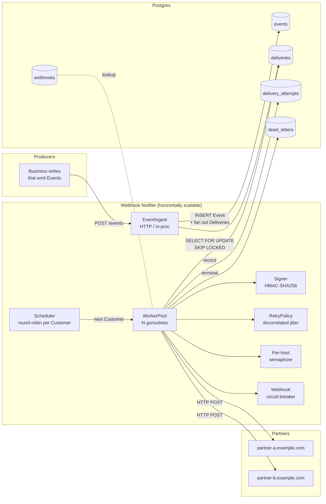
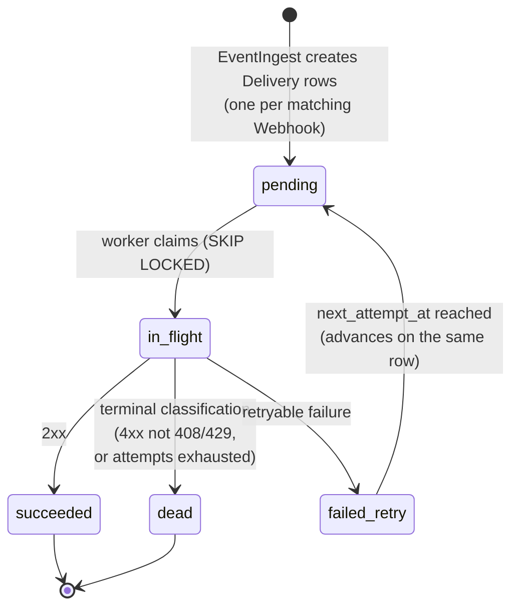

# Webhook Notifier — Design

This document describes the design of the Webhook Notifier component: a service that consumes business Events from a multi-tenant platform and reliably delivers them to Integration Partners over HTTP POST, with horizontal scalability and fair scheduling across Customers of vastly different sizes.

Vocabulary used here is defined in [CONTEXT.md](../CONTEXT.md). Architectural commitments are anchored in [ADR-0001](adr/0001-round-robin-fairness-with-pluggable-scheduler.md), [ADR-0002](adr/0002-postgres-as-queue-no-broker-for-poc.md), [ADR-0003](adr/0003-retry-policy-and-delivery-lifecycle.md), [ADR-0006](adr/0006-db-backed-claimable-customer-discovery.md), [ADR-0007](adr/0007-http-transport-and-response-body-drain.md), and [ADR-0008](adr/0008-persisted-webhook-circuit-breaker.md).

## Goals

- **Reliability**: no Event lost between business commit and final terminal state. Transient failures are retried with bounded backoff; persistent failures land in the DLQ for inspection.
- **Scalability**: workers are stateless and horizontally scalable. Adding workers increases throughput without changing claim semantics.
- **Fairness**: a Whale Customer cannot starve Small Customers. Scheduling latency for a Small Customer is bounded regardless of any other Customer's backlog. Fairness is **weighted per Customer**, with a default weight of `1` for every Customer — i.e. equal share today, with a forward-compatible path to differentiated shares (e.g. plan-tier or Whale throttling) without touching the WorkerPool or Outbox.
- **Runnable service composition**: the notifier entrypoint wires ingest, Registry, Scheduler, Outbox, HostLimiter, WorkerPool, DB-backed discovery, observability, and graceful shutdown. Package-level tests and benchmark drivers exercise mechanics, but do not replace a runnable service.

## Non-goals (PoC)

- Webhook management APIs (assumed implemented elsewhere).
- Strict per-Customer FIFO. Per-Customer queues drain in arrival order single-threaded, but with multiple workers some interleaving is possible. Documented trade-off.
- Multi-region delivery.
- Production-grade auth on the ingest path.
- Partner-side replay UI; the DLQ is a queryable table.

## High-level architecture



## Component responsibilities

### Deep modules (pure logic, isolated unit tests)

- **Scheduler** — Given the set of Customers with pending Deliveries, returns the next Customer to serve. Smooth Weighted Round Robin (SWRR, Nginx-style) with `weight=1` default for every Customer (ADR-0001) — degenerates to plain RR until weights diverge. The interface is the load-bearing contract; the implementation (RR / SWRR / DRR) is the trade-off.
  ```go
  type Scheduler interface {
      // Pick returns the next Customer to serve and an implementation-specific
      // batch hint. The worker MAY claim up to batchHint Deliveries before
      // yielding back. batchHint == 0 means "no work".
      Pick(ctx context.Context) (id CustomerID, batchHint uint32, ok bool, err error)
      Notify(CustomerID) // wake the scheduler when work arrives
  }

  // WeightSource resolves a Customer's fairness weight. Default impl returns 1
  // for every Customer; future impls read from `customers.weight` (DB) or a
  // plan-tier lookup. The Scheduler depends on this interface, not on storage.
  type WeightSource interface {
      Weight(CustomerID) uint32 // 0 = paused; >=1 = share multiplier
  }
  ```
  SWRR interleaves picks so a `[3,1]` weight set yields `AABAAABA` rather than classic contiguous `AAAB AAAB` cycles — same share, with the low-weight Customer pulled forward as much as the 3:1 ratio permits. With all weights=1, behaviour is identical to plain RR. Weight controls how often a Customer is picked. Claim batch size is a separate database-amortization knob. A throttled Customer with `weight=0` is skipped entirely (useful for incident response).
- **RetryPolicy** — `Next(attempt int, prevDelay time.Duration, resp *http.Response, err error) (delay time.Duration, terminal bool, reason string)`. Pure function. Encodes decorrelated jitter, 4xx fast-fail, 429 `Retry-After` honouring, and exhaustion (ADR-0003).
- **Signer** — `Sign(secret, body []byte, ts time.Time) (sig string)`. HMAC-SHA256 over `timestamp.body`. Deterministic.

### Service modules

- **EventIngest** — Accepts an Event and synchronously fans out one Delivery row per matching Webhook in a single transaction. Same transaction = no Delivery is ever orphaned from its Event.
  Keep synchronous fanout for the PoC: the expected Webhook count per Customer is small, and the transaction freezes routing at Event acceptance time. If ingest-latency measurements later justify asynchronous fanout, persist an immutable routing snapshot or equivalent durable fanout intent with the Event before returning success. A background fanout worker must not resolve a mutable Webhook set later and silently change which Integration Partners receive the Event.
  Track Event ingest latency by fanout size. Until a product API SLO is defined, use provisional `p99 < 200ms` under realistic Webhook fanout as the threshold for reconsidering asynchronous fanout.
- **Outbox** (the `deliveries` table) — The durable work queue. Workers claim with `SELECT ... FROM deliveries WHERE customer_id = $1 AND status IN ('pending') AND next_attempt_at <= now() FOR UPDATE SKIP LOCKED LIMIT $2` once the Scheduler has named a Customer; the `LIMIT` is a claim batch size used to amortize database work.
- **WorkerPool** — N goroutines per process. Each loop:
  1. `id, batchHint, ok := Scheduler.Pick()` — get next Customer and how many Deliveries the worker may serve before yielding.
  2. Claim up to the configured batch size for that Customer (single SQL statement). The PoC uses a default minimum batch of 32 Deliveries per pick and validates that throughput tuning against the Small Customer scheduling-latency SLO.
  3. For each claimed Delivery, in order:
     - Look up Webhook (cached).
     - Acquire per-host semaphore (skip and requeue with short backoff if blocked > short timeout; yield back to Scheduler so a saturated partner does not stall fairness).
     - `Signer.Sign()`, build HTTP request with idempotency headers.
     - POST with a shared tuned HTTP client and per-Attempt request timeout.
     - Drain and close the response body so the transport can reuse the connection.
     - `RetryPolicy.Next()` decides outcome → mutate Delivery row + record an Attempt row.
  4. Return to step 1.
- **SubscriptionRegistry** — Read-only `customer_id → []Webhook`. In-memory LRU with short TTL; cache miss falls back to PG. Avoids hot lookup on every Delivery.
- **DLQ** (`dead_letters` table) — Terminal Deliveries with reason (`exhausted`, `terminal_4xx`, `terminal_network`).
  Terminal `deliveries` rows are retained in the live queue for a configurable operational window, initially 24 hours, then archived to a time-partitioned history table and removed from `deliveries` so claim indexes do not accumulate unbounded terminal work.
- **Process-local HostLimiter** — `map[host]chan struct{}`. Enforces a per-process limit per Integration Partner hostname, default 20. This is the PoC's partial enforcement of the Host Concurrency Cap; a horizontally scaled production deployment needs fleet-wide coordination to preserve the partner-protection invariant.
- **Webhook circuit breaker** — Persisted per-Webhook breaker state (`closed`, `open`, `half_open`) that keeps chronically failing Webhooks out of claim/discovery until a cooldown permits one probe. Complements RetryPolicy and the Host Concurrency Cap: RetryPolicy decides the outcome of an Attempt, HostLimiter limits local pressure on a hostname, and the breaker stops a broken Webhook from repeatedly occupying worker capacity across many Deliveries.

## Data model

```
events                deliveries             delivery_attempts      dead_letters
─────────────         ───────────────        ─────────────────      ───────────────
id (uuid)             id (uuid)              delivery_id            delivery_id
customer_id           event_id        ──fk─> id                     last_error
type                  webhook_id             attempt_number         attempts
payload (jsonb)       customer_id            status_code            reason
created_at            status                 error_class            final_at
                      attempt_count          duration_ms
                      next_attempt_at        sent_at
                      last_error
                      created_at
                      updated_at

webhooks
───────────
id (uuid)
customer_id
url
secret (encrypted)
event_types (text[])
active (bool)
breaker_state (text)
breaker_failure_count
breaker_opened_at
breaker_next_probe_at
breaker_cooldown_ms
breaker_probe_delivery_id
```

Indexes:
- `deliveries (customer_id, status, next_attempt_at)` — scheduler/worker hot path.
- `delivery_attempts (delivery_id, attempt_number)` — audit lookup.
- `dead_letters (final_at desc)` — ops inspection.

## Lifecycle: a Delivery from cradle to terminal state



`failed_retry` is a distinct state from `pending` so dashboards distinguish "never tried" from "in backoff".

## Reliability mechanics

- **Outbox semantics**: Events and their derived Deliveries are written in the same transaction as the business write that emitted them. No business commit without scheduled delivery.
- **Claim atomicity**: `SELECT ... FOR UPDATE SKIP LOCKED` ensures no two workers ever claim the same Delivery, even across multiple instances of the service.
- **Crash recovery**: a worker that crashes mid-Delivery leaves the row in `in_flight` with `claimed_at`. A background sweeper (or a `claimed_at < now() - lease_ttl` predicate in the claim query) re-claims abandoned rows. PoC uses the latter — no separate sweeper process.
- **Idempotency contract**: every Attempt carries `X-Delivery-Id` (stable across retries of one Delivery) and `X-Event-Id` (stable across all Deliveries derived from one Event). Partners dedupe on these.

## Scalability mechanics

- **Stateless workers**: all coordination is through Postgres. Workers can be added or removed without coordination.
- **Shared HTTP transport**: each Worker owns one tuned HTTP client with large idle connection pools and explicit transport timeouts (ADR-0007). Per-Attempt deadlines come from request contexts, not `http.Client.Timeout`, so response bodies can be drained before cancellation and idle connections can be reused.
- **No leader**: the Scheduler is process-local. Postgres claim locking prevents duplicate Delivery processing across instances, but globally balanced Customer fairness requires every instance to discover the claimable Customer set from shared storage. DB-backed claimable Customer discovery is the chosen path in ADR-0006; it gives approximate cluster-wide fairness without a globally serialized Scheduler.
- **Scale ceiling**: at very high throughput, contention on the `deliveries` claim query becomes the bottleneck. The natural next step is to partition by `customer_id` (or move per-Customer queues to Redis Streams). The `Scheduler` interface already hides the queue source so this swap is local.

## Fairness mechanics

The single technical claim that drives most of the design: **the unit of fairness is the Customer, not the Delivery, not the worker, not the partner host**.

- The Scheduler iterates over **the set of Customers with pending Deliveries**, not over the Deliveries themselves. This is the key insight. If we iterated over Deliveries, a Whale's 50k-Delivery burst would dominate. Iterating over Customers gives each one a share per cycle proportional to its weight, regardless of backlog depth.
- A Customer with more Webhooks produces more Deliveries but does not receive more scheduling capacity automatically. Webhook fanout increases backlog, not share. Explicit Customer weight is the only mechanism for differentiated scheduling capacity.
- **Per-Customer concurrency cap is a complementary future safeguard.** Round-robin controls admission order, but slow Attempts from one Customer can still accumulate in flight and occupy worker capacity. Customer weight controls scheduling share; a concurrency cap would bound simultaneous resource use. It does not replace Customer-based scheduling.
- A production per-Customer concurrency cap should be fleet-wide. A process-local layer may reduce coordination load, but cannot preserve the deployment-wide bound alone. It can reuse a lease-based distributed semaphore pattern keyed by Customer, independently of the Host Concurrency Cap keyed by Integration Partner.
- **Weighted by default, equal by default.** Every Customer carries a `weight` (default `1`). The Scheduler is Smooth Weighted Round Robin (SWRR): with uniform weights it is plain RR; with diverging weights it allocates proportional, interleaved slots (no contiguous bursts for high-weight Customers). This makes the equal-share PoC and a future tiered policy the same code path — no rewrite when product introduces plan tiers, Whale throttling, or paid priority.
- **Claim batch size is independent from Customer weight.** Weight controls how often a Customer is picked. Claim batch size controls database amortization per pick. The PoC uses a default minimum batch size of 32 and should tune it against the `< 2s` Small Customer scheduling-latency SLO rather than changing fairness policy to gain throughput.
- The Host Concurrency Cap is **orthogonal** to per-Customer fairness. It protects partners. Without it, a Whale's per-cycle Delivery slots still get through, but in close succession against the same hostname — partners 429. The PoC's process-local HostLimiter requeues with a short `next_attempt_at` bump on local cap timeout and returns to the Scheduler, so a locally saturated partner never blocks Pick.
- SWRR is sufficient because Deliveries have uniform cost (one HTTP POST each) and weights are per-Customer, not per-Delivery. DRR exists for variable-cost work units; if Deliveries ever become heterogeneous (e.g. payload-size-weighted), the Scheduler implementation swaps without touching the WorkerPool (ADR-0001).
- SWRR is the PoC algorithm, not a permanent production commitment. Preserve the Customer-weight fairness contract and profile Scheduler CPU. If active-Customer growth makes SWRR material, replace it with an `O(1)` or `O(log n)` implementation while keeping the same scheduling-latency SLO.

### Weight source

```
customers
──────────
id (uuid)
weight (int, default 1, check >= 0)  -- 0 = paused
plan_tier (text, nullable)            -- optional; resolves to weight via policy
```

PoC reads weight from the `customers` table via `WeightSource`. Cache alongside the SubscriptionRegistry (short TTL). Live weight changes apply at the next Scheduler cycle — no worker restart.

## Per-host concurrency cap

```go
type HostLimiter struct {
    mu    sync.Mutex
    sems  map[string]chan struct{}
    limit int
}

func (h *HostLimiter) Acquire(ctx context.Context, host string) (release func(), err error) { ... }
```

Workers acquire before POSTing. On acquisition timeout the Delivery is requeued with a short `next_attempt_at` bump — the worker frees up to serve another Customer. This keeps fairness intact when one process saturates its local allowance.

The Host Concurrency Cap is a fleet-wide partner-protection invariant. The PoC's
in-memory HostLimiter enforces only the local portion of that allowance. A
horizontally scaled production deployment needs distributed coordination, such
as a lease-based distributed semaphore. The mechanism is deferred until
deployment scale and failure semantics are known. A request-rate policy, such
as a token bucket, would be a separate control with separate configuration; it
does not enforce the Host Concurrency Cap.

If distributed coordination is configured but unavailable, new Attempts for
affected hostnames fail closed: Requeue them with a short delay rather than
falling back to the local HostLimiter alone. Existing in-flight Attempts
continue. This avoids multiplying Integration Partner load during a limiter
incident. The production implementation should expose coordination-failure
metrics so operators can distinguish limiter outages from partner saturation.

Production coordination should key the cap by normalized `hostname:port`.
Equivalent URLs using a scheme's default port share one key, while distinct
ports may carry independent allowances. The PoC currently keys its local
HostLimiter with `url.Hostname()` only. Webhook paths and Customer identity do
not belong in the key.

Production configuration should provide a conservative default cap plus
per-key overrides for Integration Partners with known capacity. Customer-level
overrides do not belong in this policy because the Host Concurrency Cap protects
Integration Partners, not Customers.

Distributed semaphore slots should be renewable leases. Acquire a slot before
POSTing, renew it while the Attempt remains in flight, release it when the
Attempt finishes, and allow it to expire after missed renewals. The lease TTL
must exceed the renewal interval and be bounded relative to the configured
request timeout so a crashed notifier instance cannot strand partner capacity
indefinitely.

If lease renewal fails while an Attempt is still in flight, cancel the HTTP
request before the lease expires and classify the outcome as retryable
coordination loss. Allowing the request to continue after its slot can be
reissued would violate the cap. A later retry keeps the stable `X-Delivery-Id`
so the Integration Partner can deduplicate an Attempt that reached it before
cancellation took effect.

Coordination loss before POSTing is a Requeue: it does not record an Attempt or
consume the Delivery retry budget because the Integration Partner saw no
request. Renewal loss after POSTing begins records an Attempt and uses normal
retry accounting because the Integration Partner may have observed the request.
Coordination loss does not contribute to opening the Webhook Circuit Breaker:
it indicates notifier infrastructure failure, not Integration Partner
destination health. Expose it through separate metrics.

Repeated pre-dispatch Requeues caused by coordination unavailability should use
jittered exponential backoff with a cap, then reset after a slot is acquired
successfully. A fixed short delay would create avoidable database churn during
a limiter outage.

## Webhook circuit breaker

Each Webhook has a persisted circuit breaker (ADR-0008):

- `closed`: Deliveries are claimable normally. Attempt success resets the failure counter. Retryable or terminal Attempt failures increment it.
- `open`: Deliveries for that Webhook are excluded from both claim and DB-backed claimable-Customer discovery. The queued work remains in the outbox; it just does not consume worker capacity.
- `half_open`: after cooldown, the claim query atomically picks one Delivery as `breaker_probe_delivery_id`, transitions the Webhook to `half_open`, and claims only that Delivery as the probe. Probe success closes the breaker; probe failure reopens it and backs off the next cooldown.

The breaker is deliberately per-Webhook, not per-host. A single Integration Partner hostname may serve many independent Webhooks, and one broken Webhook configuration should not suppress other Customers' healthy Webhooks on the same host. The Host Concurrency Cap remains the host-level protection mechanism.

Default policy is conservative: 20 consecutive failures open the breaker, the first cooldown is 5 minutes, and repeated failed probes back off up to 15 minutes. The PoC uses consecutive failures rather than a sliding failure-rate window; that keeps the decision deterministic while still handling 100%-failing Integration Partner endpoints.

## Observability

Metrics are flagged as a discussion point in the assignment brief, but the PoC ships with the endpoints and instrumentation hooks so the discussion has concrete artefacts:

- **Prometheus `/metrics`** with:
  - `webhook_deliveries_total{status="succeeded|dead"}`
  - `webhook_delivery_latency_seconds{customer_class="whale|small"}` (histogram, enqueue → terminal)
  - `webhook_attempts_per_delivery` (histogram)
  - `webhook_dlq_total{reason}`
  - `webhook_scheduler_pick_duration_seconds`
  - `webhook_host_semaphore_wait_seconds{host}`
  - `webhook_breaker_state{webhook_id,state}`
  - `webhook_breaker_trips_total{reason}`
- **`/health`** and **`/ready`** endpoints.
- **`/debug/pprof`** mounted behind a flag.
- **Structured logging** via `log/slog` with `customer_id`, `event_id`, `delivery_id`, `attempt_number` fields on every line.

Dashboards and alerting are pair-session discussion: which p99 thresholds warrant paging, what fairness-violation alerts look like, how to detect a slow partner before its queue depth blows the SLO.

## Testing strategy

### Unit tests

- **Scheduler**: table-driven coverage of empty schedule, single-Customer back-to-back, multi-Customer round-robin invariant, and weighted invariant. Property test: over any arrival/draw sequence, each Customer's share equals `weight_i / Σ weight_j ± ε`. Uniform-weight case reduces to the equal-share invariant. `weight=0` Customers are never picked while pending.
- **RetryPolicy**: truth table from ADR-0003.
- **Signer**: vector tests with known fixtures.

### Integration tests

- **Outbox claim atomicity**: real Postgres (testcontainers). Spawn K concurrent workers, claim N Deliveries, assert no duplicates.
- **End-to-end happy path**: ingest → POST → success → row state.

### Benchmark scenarios

Each scenario lives in `cmd/bench` and emits a markdown report under `bench/results/`. The five scenarios collectively cover all reliability/fairness/scalability claims.

| Scenario | Setup | Pass criteria | Claims exercised |
| --- | --- | --- | --- |
| **1. Fairness under load + late-arrival reactivity** | 1 Whale (50k Deliveries burst) + 100 Smalls (5 each, 1/sec). At t=30s inject a brand-new Small. | Smalls p99 < 2s; late Small first-Delivery latency bounded to one RR cycle. | Steady-state fairness, scheduler reactivity. |
| **2. Transient + recovering partners** | 10 Customers; 100 Events per Customer by default; 3 Webhooks per Customer, one per fake partner hostname. Partner A is healthy, Partner B deterministically returns 5xx for 30% of Attempts, and Partner C returns 503 during a wall-clock outage window before recovering. | 100% terminal; Partner-C Deliveries whose first Attempt occurred during the outage succeed after recovery; Partner-A lifecycle p99 < 2s; no single post-recovery 1s retry bucket contains >25% of Partner-C retry Attempts. | Retry policy, decorrelated jitter (no thundering herd), per-host isolation, Event × Webhook fanout. |
| **3. Terminal classification (fail-fast on 4xx)** | 1 Customer, 2 Webhooks: one good, one returning 404. 1000 Events. | Broken Webhook Deliveries: 1 Attempt each → `dead` with `reason=terminal_4xx`. Good Webhook: all `succeeded`. | Terminal classification, no retry waste on misconfig. |
| **4. Horizontal scale + claim atomicity + idempotency** | 10k Deliveries at worker count {1, 4, 8}. Receiver records every `(delivery_id, attempt_number, X-Delivery-Id)` tuple. | Throughput at 8 ≥ 4× throughput at 1. Zero duplicate `(delivery_id, attempt_number)`. `X-Delivery-Id` stable across retries. | Scalability, claim atomicity, idempotency-header stability. |
| **5. Dead partner circuit breaker + pool protection** | 10 Customers with one Webhook each. Customer 1 targets a hanging endpoint; Customers 2-10 target healthy 2xx endpoints. Compare against a control run with all healthy endpoints. | Dead Webhook opens breaker and later probes via half-open. Healthy Customers' p95 remains within 10% of control after breaker opening. Breaker trip metrics and goroutine return-to-baseline checks pass. | Breaker isolation, noisy-neighbor protection, worker pool resilience under dead partner conditions. |

## What is deliberately out

- **DRR implementation** — interface ready, implementation deferred (ADR-0001). PoC ships WRR with uniform weights.
- **Plan-tier → weight policy** — the WRR + `WeightSource` plumbing is in place, but the actual tier table and admin UI to set non-uniform weights are out of PoC scope. Adding them is a config change, not a redesign.
- **Redis Streams per-Customer queues** — same Scheduler interface (ADR-0002).
- **Per-Customer concurrency cap** — round-robin already paces; documented as natural addition under DRR.
- **Many-Whale contention bench** — scenario 1 already proves the mechanism.
- **Mid-flight worker crash chaos scenario** — recoverable by design (`claimed_at` predicate), demonstrated by an integration test rather than a bench scenario.
- **Multi-region**.
- **Webhook management APIs**.

## Risks and open trade-offs

- **No strict per-Customer FIFO.** Documented; partners are expected to handle out-of-order Events on their side using `X-Event-Id` and `created_at`.
- **In-process Scheduler means per-instance round-robin.** Cross-instance duplicate prevention comes from Postgres claim semantics; cross-instance fairness is only approximate until workers periodically discover claimable Customers from shared storage. Under imbalance, one instance can have a stale or partial claimable Customer view. Bounded by claim batch size once discovery is in place.
- **Fleet-wide fairness targets bounded Small Customer scheduling latency, not an exact global order.** DB-backed discovery should converge each process toward the shared claimable Customer set and prevent starvation. If multi-instance benchmarks show the scheduling-latency SLO is violated, escalate to Customer leasing or broker-backed per-Customer queues rather than globally serializing every Scheduler pick by default.
- **Fairness SLO uses Small Customer scheduling latency.** Measure the time from a Delivery becoming claimable to its first claim and evaluate p99 for Small Customers under Whale load. This isolates scheduling behavior from Integration Partner response time and retries. End-to-end Delivery latency remains a separate reliability metric.
- **Initial Small Customer scheduling-latency SLO: p99 < 2 seconds under Whale load.** This matches Bench Scenario 1 and is a provisional product target to validate against production traffic assumptions. It is not a guarantee during dependency outages.
- **Retry-due Deliveries use the same fairness SLO once claimable.** Their scheduling-latency clock starts when `next_attempt_at` is reached, not while they are intentionally in backoff. Once due, they compete normally by Customer so recovering Integration Partners are not starved behind fresh Whale traffic.
- **Reclaimable stale `in_flight` Deliveries use the same fairness SLO after claim-lease expiry.** Before lease expiry they remain owned by the original worker. After expiry they compete normally by Customer. Track reclaimed Deliveries separately so crash-recovery latency remains visible.
- **Customers with only future work leave local Scheduler rotation.** A Customer whose remaining Deliveries are all waiting for `next_attempt_at` or claim-lease expiry is not claimable yet. Remove it from local rotation after an empty claim; DB-backed discovery re-adds it when work becomes claimable. This avoids hot Postgres polling during backoff.
- **Postgres as queue has a throughput ceiling.** Bench scenario 4 measures it; the scale-out path is in ADR-0002.

## Repo layout (planned)

```
.
├── CONTEXT.md
├── CLAUDE.md
├── docs/
│   ├── DESIGN.md
│   └── adr/
├── cmd/
│   ├── notifier/       # service entrypoint
│   └── bench/          # benchmark harness CLI
├── internal/
│   ├── ingest/
│   ├── scheduler/      # Scheduler interface + round-robin impl
│   ├── retry/          # RetryPolicy
│   ├── signer/         # Signer
│   ├── worker/         # WorkerPool, host limiter
│   ├── outbox/         # Postgres claim/persist
│   ├── registry/       # SubscriptionRegistry
│   └── observe/        # metrics, logging, pprof wiring
├── migrations/         # golang-migrate SQL files
├── bench/
│   ├── receiver/       # configurable test receiver
│   ├── scenarios/      # scenario drivers
│   └── results/        # committed run outputs
├── docker-compose.yml
├── Makefile
└── go.mod
```
