# Architecture Diagrams

The SVG files are the human-readable architecture documentation. The Mermaid
`.mmd` files are editable source and are not the primary review format.

## Overall Architecture

[Open full-size SVG](overall-architecture.svg)

## Multi-Customer Claiming

**What:** one database claim can collect bounded work from several Customers.

**Why:** sparse Customer workloads should not pay one database round-trip per
Delivery, while a Whale Customer must not monopolize the shared batch.

[Open full-size SVG](claim-next-batch.svg)

## Webhook Circuit Breaker

**What:** in-memory decisions drive `closed`, `open`, and `half_open`
transitions, with persisted state controlling cross-replica claims.

**Why:** broken Webhooks should stop consuming worker capacity without adding a
Webhook-row update to every delivery outcome.

[Open full-size SVG](breaker-lifecycle.svg)

## Retry Policy

**What:** classifies success, retryable failure, terminal failure, exhaustion,
and optional age expiration.

**Why:** every Worker must apply the same bounded reliability policy and avoid
retry storms.

[Open full-size SVG](retry-policy.svg)

## Delivery Lifecycle

**What:** shows the durable states a Delivery passes through from fanout to
success or dead-lettering.

**Why:** distinguishes a temporary claim lease from persisted Delivery status
and makes crash recovery visible.

[Open full-size SVG](delivery-lifecycle.svg)

## Host Limiter

**What:** caps process-local concurrent Attempts per Integration Partner
hostname and Requeues work when capacity is unavailable.

**Why:** one slow or overloaded partner should not occupy all local delivery
capacity or consume retry budget before a request is sent.

[Open full-size SVG](host-limiter.svg)

## Maintaining Diagrams

Run `just diagrams` after editing a Mermaid source. Run `just diagrams-check`
to verify every committed SVG matches its source. Both commands use pinned
Mermaid CLI `11.12.0`.
